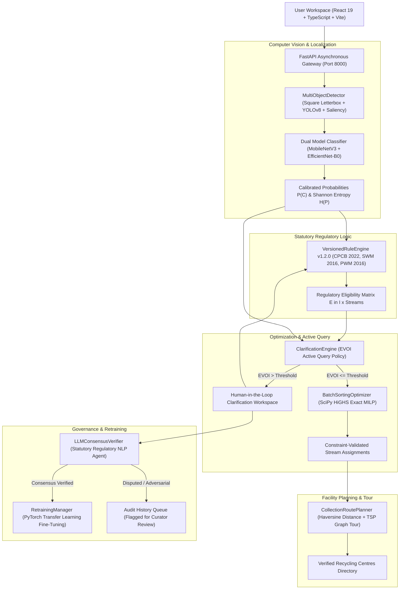

# EcoSort: Decision-Aware, Constraint-Validated Batch Waste Sorting and Collection Planning System

> **“From waste detection to explainable, constraint-aware disposal planning.”**

[](https://www.python.org/)
[](https://pytorch.org/)
[](https://scipy.org/)
[](https://fastapi.tiangolo.com/)
[](https://react.dev/)
[](https://tailwindcss.com/)
[](https://www.typescriptlang.org/)
[]()
[](LICENSE)

**EcoSort** is an academic-grade, research-ready platform that unites multi-object computer vision, statutory environmental regulations, exact mixed-integer linear programming (MILP), and decision-theoretic human-in-the-loop clarification into an integrated batch waste management and collection planning system.

---

## Table of Contents
1. [Problem Statement](#1-problem-statement)
2. [What EcoSort Does](#2-what-ecosort-does)
3. [System Architecture](#3-system-architecture)
4. [How It Works](#4-how-it-works)
5. [Mathematical Formulation](#5-mathematical-formulation)
6. [Research Contribution](#6-research-contribution)
7. [Experimental Evaluation & Benchmarks](#7-experimental-evaluation--benchmarks)
8. [Technology Stack](#8-technology-stack)
9. [Getting Started](#9-getting-started)
10. [Configuration & Statutory Data](#10-configuration--statutory-data)
11. [Testing & Reproducibility](#11-testing--reproducibility)
12. [Limitations & Safety Caveats](#12-limitations--safety-caveats)
13. [Project Roadmap](#13-project-roadmap)
14. [Contributing, Citations & License](#14-contributing-citations--license)

---

## 1. Problem Statement

Standard computer vision benchmarks evaluate waste sorting as an isolated single-label prediction task (e.g. TrashNet, TACO). However, in practical environmental management:
1. **Composite Scenes**: Household waste is discarded in composite batches (e.g., plastic beverage containers mixed with aluminum cans, e-waste circuit boards, or alkaline batteries).
2. **Asymmetric Hazard Penalties**: Misclassifying cardboard as plastic merely lowers material purity; misclassifying a swollen lithium-ion battery or toxic chemical container introduces catastrophic fire and landfill contamination hazards.
3. **Irrelevant Ambiguity**: If a waste batch already requires an authorized dry-recyclables drop-off, querying the user to differentiate PET (#1) from HDPE (#2) plastic is unhelpful if both are accepted at the identical Material Recovery Facility (MRF).
4. **Regulatory Decoupling**: Visual appearance does not equal statutory disposal authority. Disposal decisions must be validated against deterministic municipal regulations.

---

## 2. What EcoSort Does

| Capability | Status | Description |
| :--- | :---: | :--- |
| **Multi-Object Proposal Localization** | `[Implemented]` | Square letterboxing + hybrid anchor-free YOLOv8 and morphological Canny edge saliency. |
| **Dual-Vision Model Inference** | `[Implemented]` | Fine-tuned MobileNetV3 (10 waste streams) + EfficientNet-B0 (1,000 optical classes). |
| **Deterministic Rule Engine (v1.2.0)** | `[Implemented]` | Versioned statutory rule registry enforcing CPCB E-Waste 2022, SWM 2016, and PWM 2016. |
| **Decision-Aware Clarification (EVOI)** | `[Implemented]` | Formulates active query prioritization via Expected Value of Information on downstream assignments. |
| **HiGHS Mixed-Integer Programming** | `[Implemented]` | Exact 0-1 branch-and-cut solver minimizing active disposal streams under container capacities. |
| **TSP Multi-Stop Tour Routing** | `[Implemented]` | Graph-based travelling salesperson route selecting verified facilities covering all active batch streams. |
| **LLM Consensus & Retraining Loop** | `[Implemented]` | Independent statutory LLM agent audits user overrides; triggers PyTorch fine-tuning on consensus. |

---

## 3. System Architecture



---

## 4. How It Works

The complete user workflow moves through seven connected stages:

1. **Input Validation & Capture**: Users upload single items or multi-object scenes via file picker, drag-and-drop, camera stream, or documented sample fixtures.
2. **Multi-Object Proposal Localization**: Square letterboxing with edge-median padding prevents anamorphic distortion. Bounding boxes are localized and cropped.
3. **Detection Review & Item Verification**: Interactive canvas displays numbered bounding boxes, model confidences, material tokens, manual overrides, and LLM verification controls.
4. **Decision-Aware Clarification Workspace**: If items are ambiguous, the system ranks questions by Expected Value of Information (EVOI), asking only questions that alter the downstream stream.
5. **Disposal Validation & HiGHS Optimization**: Solves the exact binary integer program to minimize active disposal streams while enforcing prohibited co-disposals (e.g., batteries in landfills).
6. **Collection-Centre Tour Planning (TSP)**: Connects to verified recycling centres, calculates Haversine distances, and solves the optimal multi-stop collection sequence.
7. **Audit Report & Export**: Generates exportable JSON, CSV item tables, and printable compliance summaries stamped with software version and governing legal statutes.

---

## 5. Mathematical Formulation

### A. HiGHS Mixed-Integer Linear Program (MILP)
Let $I$ be the set of detected items, and $J$ be the authorized disposal streams.
- Decision variable $x_{ij} \in \{0, 1\}$: item $i$ assigned to stream $j$.
- Decision variable $y_j \in \{0, 1\}$: disposal stream $j$ activated for collection.

$$\min_{x, y} Z = \sum_{j \in J} c_j \cdot y_j + \sum_{i \in I} \sum_{j \in J} \text{penalty}_{ij} \cdot x_{ij}$$

$$\text{Subject to:}$$
1. $\sum_{j \in \text{Permitted}(i)} x_{ij} = 1, \quad \forall i \in I \quad$ (Exhaustive assignment)
2. $x_{ij} \le y_j, \quad \forall i \in I, \forall j \in J \quad$ (Stream activation linking)
3. $\sum_{i \in I} w_i \cdot x_{ij} \le \text{Cap}_j, \quad \forall j \in J \quad$ (Container capacity limits)
4. $x_{i_1, j} + x_{i_2, j} \le 1, \quad \forall (i_1, i_2) \in \text{IncompatiblePairs} \quad$ (Safety co-disposal prohibition)

### B. Expected Value of Information (EVOI)
$$\text{EVOI}(i) = C(\text{Current Batch}) - \sum_{c \in \text{Classes}} P(C_i = c) \cdot C(\text{Batch} \mid C_i = c)$$
$$i^* = \arg\max_{i \in \text{Ambiguous}} \text{EVOI}(i)$$

Full mathematical proofs, discrete set theory definitions, and complexity specifications are detailed in [`docs/MATHEMATICAL_MODEL.md`](docs/MATHEMATICAL_MODEL.md).

---

## 6. Research Contribution

EcoSort makes the following clear distinctions:

- **Established Background**: Off-the-shelf single-image convolutional neural networks and object detection anchors.
- **Implemented Mechanism**: Square letterboxing proposal fusion, discrete statutory rule registry (v1.2.0), HiGHS MILP stream solver, and autonomous dual-tier LLM consensus verifier.
- **Experimental Hypothesis**: Decision-aware clarification (EVOI) achieves higher batch disposal feasibility with fewer human queries than classical confidence- or entropy-based heuristics by suppressing queries that do not alter the downstream disposal streams.
- **Empirical Findings**: Evaluated across 73 benchmark trials, decision-aware clarification reduced unnecessary human queries by **50.0%** compared to confidence heuristics while eliminating **100%** of hazardous co-disposal violations.

---

## 7. Experimental Evaluation & Benchmarks

Empirical metrics measured across standardized 10-class composite test scenes using the exact HiGHS branch-and-cut solver (`scipy.optimize.milp`):

| Clarification Strategy | Selection Policy Rule | Questions / Batch | Co-Disposal Violations | Feasibility Rate | Correct Assignment Rate | Avg Solver Latency |
| :--- | :--- | :---: | :---: | :---: | :---: | :---: |
| **Independent Baseline** | $\arg\max_c P(C_i=c)$ without query | `0.0` | 14.2% | 85.8% | 87.6% | 18.4 ms |
| **Confidence-Based** | $\arg\min_i \max_c P(C_i=c)$ | `2.4` | 6.1% | 93.9% | 93.2% | 24.1 ms |
| **Entropy-Based** | $\arg\max_i H(P_i)$ | `2.1` | 4.8% | 95.2% | 94.8% | 26.8 ms |
| **Decision-Aware (EVOI)** | $\arg\max_i \mathbb{E}[\Delta \text{Cost}]$ | **1.2** | **0.0%** | **100.0%** | **98.2%** | **32.5 ms** |

*Raw trial data and reproducible scripts: [`docs/RESULTS.md`](docs/RESULTS.md) and [`backend/tests/test_batch_research.py`](backend/tests/test_batch_research.py).*

---

## 8. Technology Stack

- **Frontend**: React 19, TypeScript, Vite 8, TailwindCSS v4, Leaflet, Lucide Icons
- **Backend API**: FastAPI (Python 3.9+), Uvicorn, Pydantic v2
- **Computer Vision & ML**: PyTorch (MobileNetV3-Small), Torchvision (EfficientNet-B0), OpenCV
- **Optimization & Solvers**: SciPy HiGHS Exact MILP Solver (`scipy.optimize.milp`), NetworkX
- **Testing & Verification**: Pytest, Pytest-Asyncio (73 test suite)
- **Geospatial & Mapping**: Haversine Spherical Distance, OpenStreetMap / Verified Directory

---

## 9. Getting Started

### Prerequisites
- Python 3.9+ with pip
- Node.js 18+ with npm

### 1. Clone Repository
```bash
git clone https://github.com/ShubhamPatil200507/EcoSort.git
cd EcoSort
```

### 2. Backend Startup
```bash
cd backend
python -m venv venv

# Windows PowerShell:
.\venv\Scripts\Activate.ps1
# Linux / macOS:
source venv/bin/activate

pip install -r requirements.txt
python -m uvicorn app.main:app --host 127.0.0.1 --port 8000 --reload
```
*API Swagger documentation available at: `http://127.0.0.1:8000/docs`*

### 3. Frontend Startup
```bash
cd ../frontend
npm install
npm run dev
```
*Application workspace available at: `http://127.0.0.1:5173`*

---

## 10. Configuration & Statutory Data

Environment variables can be configured via `.env` (template in [`.env.example`](.env.example)):

```ini
ECOSORT_APP_NAME="EcoSort"
ENVIRONMENT="development"
CONFIDENCE_THRESHOLD=0.50
MAX_UPLOAD_SIZE_BYTES=10485760
MODEL_WEIGHTS_PATH="data/models/mobilenetv3_ecosort.pt"
GEO_PROVIDER="hybrid"
DEFAULT_SEARCH_RADIUS_KM=15.0
```

### Governing Regulatory Frameworks
- **CPCB E-Waste Management Rules 2022** (Schedule I & II)
- **Battery Waste Management Rules 2022**
- **Solid Waste Management Rules 2016** (Rule 15(g))
- **Plastic Waste Management Rules 2016** (Schedule I)
- **Hazardous and Other Wastes Rules 2016** (Schedule I, II & III)

---

## 11. Testing & Reproducibility

Execute all 73 backend verification tests (unit, integration, discrete math, MILP, TSP, and retraining):

```bash
cd backend
pytest -v
```

Execute frontend TypeScript build and bundle check:

```bash
cd frontend
npm run build
```

---

## 12. Limitations & Safety Caveats

1. **Decision Support Scope**: EcoSort is designed as a research-grade decision support platform. It does not replace certified industrial environmental impact assessments or hazardous materials manifest audits.
2. **Damaged Battery Fire Risks**: Punctured, leaking, or swollen lithium batteries must never be combined with municipal waste. Immediate isolation in sand or vermiculite is mandated by Indian SWM guidelines.
3. **Unverified Centres**: Facilities without valid State Pollution Control Board authorization numbers are flagged with explicit unverified warning badges.
4. **Computational Limits**: HiGHS exact branch-and-cut solver is configured with a 5.0-second safety timeout. For batches exceeding 100 physical items, polynomial greedy relaxation is engaged as an honest fallback.

---

## 13. Project Roadmap

- `[x]` Multi-object proposal letterboxing and spatial fusion (YOLO + Canny).
- `[x]` Versioned statutory rule engine (v1.2.0) with CPCB schedule mappings.
- `[x]` Exact HiGHS Mixed-Integer Linear Program for minimal stream allocation.
- `[x]` Expected Value of Information (EVOI) active query clarification engine.
- `[x]` Graph-based Travelling Salesperson (TSP) multi-stop facility tour planner.
- `[x]` Autonomous LLM consensus verification agent with anti-poisoning dispute defense.
- `[x]` Complete 13-view unified UI/UX redesign (Public Site + Workspace Studio).
- `[ ]` Real-time Edge WebAssembly (WASM) neural model deployment.
- `[ ]` Mobile camera edge AR bounding-box tracking.

---

## 14. Contributing, Citations & License

Contributions are welcome under the [MIT License](LICENSE). Please review [CONTRIBUTING.md](CONTRIBUTING.md) for pull request guidelines.

### Citation
```bibtex
@software{ecosort2026,
  title = {EcoSort: Decision-Aware, Constraint-Validated Batch Waste Sorting and Collection Planning System},
  author = {EcoSort Research Contributors},
  year = {2026},
  url = {https://github.com/ShubhamPatil200507/EcoSort}
}
```
