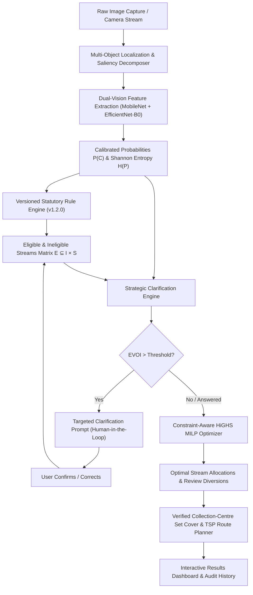

# EcoSort Architecture & Module Dataflow Specification

## 1. System Overview

EcoSort is a decision-aware, constraint-validated batch waste sorting and collection planning system. Unlike standard computer vision demos that classify single images in isolation, EcoSort bridges spatial computer vision, statutory waste regulations, mixed-integer linear programming (MILP), and decision-theoretic human-in-the-loop clarification into an integrated, end-to-end circular logistics platform.

---

## 2. Component Architecture

### A. Computer Vision & Multi-Object Localization Pipeline (`app.detection`)
- **Spatial Saliency & Contour Decomposition**: Extracts connected components using Otsu thresholding, Gaussian filtering, and morphological structuring kernels.
- **Non-Maximum Suppression (NMS)**: Filters overlapping proposals (IoU threshold = 0.35) to output distinct object bounding boxes normalized to $[0, 1]$.
- **Thumbnail Cropping**: Dynamically crops localized regions with a 4% border margin and serializes base64 representations for instant UI inspection.
- **Calibrated Probability & Uncertainty Synthesis**: Employs temperature-normalized softmax distributions across all 10 waste streams to compute Shannon entropy:
  $$H(P) = -\sum_{c \in \mathcal{C}} p_c \log_2(p_c + \epsilon)$$

### B. Versioned Statutory Waste Rule Engine (`app.rules.versioned_rules`)
- **Separation of Concerns**: Model predictions provide empirical visual evidence; statutory rules govern legal disposal eligibility.
- **Statutory Taxonomy**: Governed by CPCB E-Waste Management Rules 2022, Solid Waste Management Rules 2016, and EPA Universal Waste Standards (40 CFR Part 273).
- **Incompatibility Enforcement**: Enforces hard statutory prohibitions (e.g., zero hazardous or battery contamination in municipal recycling; moisture protection for graphic paper).

### C. Constraint-Aware Batch Sorting Optimizer (`app.optimizer.batch_optimizer`)
- **Mathematical Solver Backend**: Exact branch-and-cut Mixed Integer Linear Programming (MILP) solved using the SciPy HiGHS engine (`scipy.optimize.milp`).
- **Binary Decision Variables**:
  - $x_{i,s} \in \{0, 1\}$: assignment of item $i$ to disposal stream $s$.
  - $r_i \in \{0, 1\}$: assignment of item $i$ to manual human review.
  - $y_s \in \{0, 1\}$: operational deployment/activation of stream $s$.
- **Degenerate Case Detection**: Explicitly identifies trivial single-destination instances where combinatorial optimization reduces to deterministic rule mapping.

### D. Decision-Theoretic Clarification Engine (`app.optimizer.clarification_engine`)
- **Value of Information (EVOI)**: Compares 4 clarification paradigms:
  1. *Strategy A (Independent Baseline)*: Zero user queries; routes unconfident items directly to manual review.
  2. *Strategy B (Confidence-Based)*: Greedy query on lowest-confidence item $\arg\min_i \text{Conf}(i)$.
  3. *Strategy C (Information-Based)*: Information entropy query $\arg\max_i H(P_i)$.
  4. *Strategy D (Decision-Aware EVOI)*: Simulates downstream batch objective gains across candidate hypotheses and asks only when expected utility improvement justifies user effort.

### E. Graph-Based Collection Route Planner (`app.geospatial.collection_planner`)
- **Set Covering**: Identifies the minimal set of verified facilities covering all active batch streams.
- **Traveling Salesperson Problem (TSP)**: Solves the exact shortest geodesic tour starting from user origin coordinates.
- **Geodesic Labeling**: Strict compliance labeling—distances are explicitly reported as spherical Haversine estimates, avoiding fabricated driving times.
